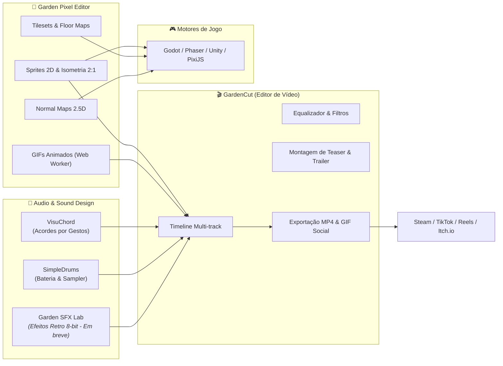

# 🌿 Garden Pixel Editor no Ecossistema Garden Apps (GC Studio)

> O **Garden Pixel Editor** é o pilar de **Computação Gráfica Raster & Criação Visual** da suíte **Garden Apps**, desenvolvida pelo estúdio criativo **GC Studio** (Felipe Gardenghi).

---

## 🎯 A Filosofia da Suíte Garden Apps

O ecossistema **Garden Apps** foi construído sob quatro pilares inegociáveis de engenharia de software moderna:
1. **100% Web & Client-Side First:** Processamento de ponta executado diretamente no hardware do usuário (CPU/GPU) através de Web Workers, Web Audio API, Canvas 2D e WebGL, eliminando o custo de servidores de processamento e garantindo privacidade total.
2. **Desacoplamento e Baixo Nível:** Motores matemáticos isolados de frameworks de UI (como o `PixelBuffer` em `Uint32Array` do Garden Pixel Editor e a timeline matemática do GardenCut).
3. **PWA & Instalação Offline:** Todos os aplicativos funcionam desconectados da internet e podem ser instalados como aplicativos nativos.
4. **Interoperabilidade Fluida:** Os dados e mídias fluem entre as ferramentas sem atritos ou barreiras proprietárias.

---

## 🔄 Fluxo de Interoperabilidade Criativa

---

## 🤝 Conexões com Outros Apps do GC Studio

### 1. 🎬 Integração com o GardenCut (Editor de Vídeo Web)
* **Trailers e Teasers de Games:** O desenvolvedor desenha o personagem ou animação no Garden Pixel Editor e o exporta como GIF transparente ou tira de quadros. No **GardenCut**, o clipe é importado instantaneamente na trilha de sobreposição (`track-overlay`), permitindo animar escala, rotação e posição com **Keyframes**, adicionar efeitos sonoros e gerar trailers para a Steam e redes sociais.
* **Pós-Produção Direta:** O GardenCut agora oferece suporte completo a overlays Picture-in-Picture, tornando simples sobrepor gameplays e sprites animados com sincronização de batida musical.

### 2. 🎵 Integração com VisuChord & SimpleDrums
* **Composição de Cenários Sonoros:** Enquanto os assets visuais ganham vida no Garden Pixel Editor, trilhas rítmicas e melodias podem ser testadas e compostas via **SimpleDrums** e **VisuChord** para validar o ritmo e a atmosfera da cena antes de exportar o pacote para a engine de jogo.

### 3. 🚀 Novos Serviços em Roadmap do GC Studio
* **Garden SFX Lab:** Gerador procedural chiptune para criar passos, saltos, ataques de espada e sons de magia compatíveis com os frames desenhados no Pixel Editor.
* **Garden World / Tilemap Builder:** Construtor de fases focado em posicionar os tilesets isométricos 2:1 em malhas de mapa e exportar os dados em JSON para Godot, Phaser ou Tiled.
* **Garden Font Studio:** Gerador de tipografias bitmap em pixel art para caixas de diálogo e interfaces de usuário.

---

## 🏛️ Central GC Studio
Para acessar e conhecer toda a suíte de aplicativos e jogos, visite a central oficial do **GC Studio**:
👉 [https://github.com/FelipeGardenghiDev/gcstudio](https://github.com/FelipeGardenghiDev/gcstudio)
