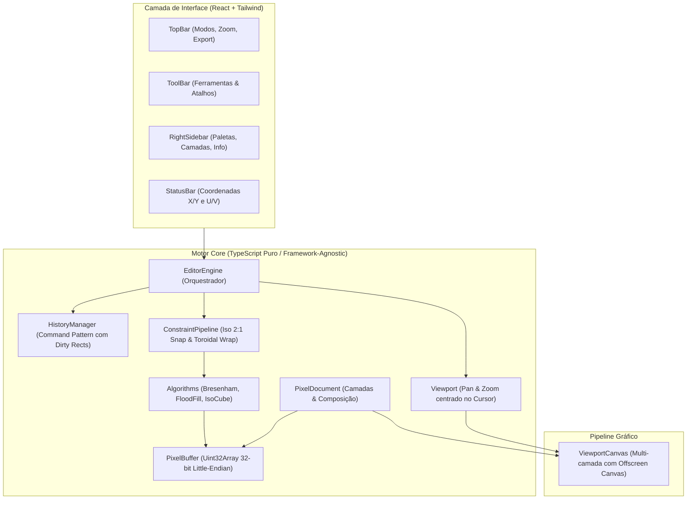

# 🌿 Garden Pixel Editor

> **Editor web moderno e especializado em Pixel Art**, com suporte nativo a **projeções por estilo** (Isométrico 2:1, Tileset Seamless Wrap e 2D Ortográfico clássico).

[](https://www.typescriptlang.org/)
[](https://react.dev/)
[](https://vitejs.dev/)
[](https://tailwindcss.com/)

---

## 🎯 Por que o Garden Pixel Editor?

A maioria dos editores tradicionais (como Aseprite e Piskel) foi desenhada como telas 2D ortográficas planas. Quando artistas precisam criar **arte isométrica** ou **tilesets contínuos**, o processo se torna manual e frustrante: é necessário contar pixels para manter o ângulo 2:1, evitar *jaggies* (degraus irregulares) e testar repetições em ferramentas externas.

O **Garden Pixel Editor** resolve isso tornando os **estilos de projeção cidadãos de primeira classe**: as ferramentas e o pincel adaptam seu comportamento matemático dependendo do modo ativo.

---

## 📐 Modos de Estilo & Projeção

### 1. 🔷 Modo Isométrico 2:1 (Dimétrico canônico de jogos)
* **Trava Angular 2:1 Nativa:** A ferramenta de Linha (`L`) trava automaticamente nos eixos de **$\pm 26.565^\circ$ ($\Delta x = \pm 2, \Delta y = 1$)** e vertical **$90^\circ$**, garantindo traços perfeitamente limpos e sem pixels desalinhados.
* **Ferramenta de Bloco 3D (`C`):** Permite clicar e arrastar para gerar prismas isométricos volumétricos completos com **faces superior, esquerda e direita sombreadas dinamicamente** a partir da cor escolhida.
* **Grade Isométrica em Diamante:** Guia visual calculada diretamente em espaço de canvas.
* **Coordenadas Isométricas $(U, V)$:** Exibição da posição na projeção isométrica em tempo real na barra de status.

### 2. 🔁 Modo Tileset Seamless (Wrap-around Contínuo)
* **Canvas Toroidal:** Pinceladas que ultrapassam qualquer borda dobram instantaneamente para a borda oposta ($X \pmod W, Y \pmod H$).
* **Ghost Preview 3×3:** O canvas renderiza 8 cópias translúcidas ao redor da área central em tempo real, permitindo avaliar a continuidade do padrão sem sair do editor.

### 3. ⬛ Modo 2D Ortográfico Clássico
* Modo pixel art tradicional 1:1, com suporte à tecla <kbd>Shift</kbd> na ferramenta de Linha para travar em $0^\circ, 45^\circ$ ou $90^\circ$.

---

## 🏛️ Arquitetura do Software

O projeto segue uma arquitetura desacoplada e modular:



### Principais Decisões de Engenharia:
1. **Desacoplamento Total do Core:** Toda a lógica gráfica e de regras matemáticas reside em `src/core/`, permitindo testes unitários fáceis ou portabilidade para desktop (Electron/Tauri) sem tocar na engine.
2. **Buffer 32-bit (`Uint32Array`):** Cores representadas diretamente como inteiros de 32 bits (`0xAABBGGRR`), permitindo operações de acesso e blending ultrarrápidas via bitwise.
3. **Undo/Redo Leve via Dirty Rects:** Em vez de clonar o canvas inteiro a cada traço, o `DrawRectCommand` grava apenas o retângulo delimitador $[minX, minY, width, height]$ dos pixels alterados, mantendo o consumo de memória estável mesmo após centenas de ações.
4. **Escala Nearest-Neighbor sem Blur:** Renderização com `imageSmoothingEnabled = false` para nitidez absoluta em qualquer nível de zoom (1x a 64x).

---

## 📁 Estrutura de Diretórios

```
garden-pixel-editor/
├── src/
│   ├── core/                        # Motor Core em TypeScript Puro
│   │   ├── types.ts                 # Tipagens centrais (Point, Rect, Layer, ToolType, ProjectionMode)
│   │   ├── color.ts                 # Utilitários de cor 32-bit e alpha blend
│   │   ├── pixel-buffer.ts          # Matriz de pixels com suporte a extração/blitting
│   │   ├── history.ts               # Histórico de Undo/Redo com Dirty Rects
│   │   ├── constraints.ts           # Algoritmos de trava angular 2:1 e wrap de coordenadas
│   │   ├── algorithms.ts            # Bresenham, Flood Fill e Gerador de Cubos 3D
│   │   ├── document.ts              # Modelo de documento, múltiplas camadas e composição
│   │   ├── viewport.ts              # Câmera com Pan e Zoom centrado no cursor
│   │   ├── editor-engine.ts         # Orquestrador central e gerenciador de eventos
│   │   ├── palettes.ts              # Paletas clássicas embutidas
│   │   └── export.ts                # Exportador PNG em escalas 1x a 16x
│   ├── components/                  # Componentes de Interface (React)
│   │   ├── ViewportCanvas.tsx       # Canvas interativo com grid e preview de tiling
│   │   ├── TopBar.tsx               # Barra superior com seletores e exportação
│   │   ├── ToolBar.tsx              # Barra de ferramentas vertical
│   │   ├── RightSidebar.tsx         # Paletas de cores, camadas e guia de estilo
│   │   └── StatusBar.tsx            # Barra de status com coordenadas reais e isométricas
│   ├── App.tsx                      # Casca da aplicação e listener de atalhos globais
│   ├── index.css                    # Configuração de tema e Tailwind CSS v4
│   └── main.tsx                     # Ponto de entrada React
├── package.json
└── vite.config.ts
```

---

## ⌨️ Atalhos de Teclado

| Tecla | Ação |
| :--- | :--- |
| <kbd>Espaço</kbd> + Arrastar | Panning da Câmera |
| <kbd>Scroll do Mouse</kbd> | Zoom suave centrado no cursor |
| <kbd>B</kbd> | Lápis / Pincel |
| <kbd>E</kbd> | Borracha |
| <kbd>L</kbd> | Reta (trava em 2:1 no modo isométrico) |
| <kbd>R</kbd> | Retângulo 2D |
| <kbd>C</kbd> | Bloco 3D Isométrico (com luz e sombra) |
| <kbd>G</kbd> | Balde de Tinta (*Flood Fill*) |
| <kbd>I</kbd> | Conta-gotas (*Color Picker*) |
| <kbd>Ctrl+Z</kbd> | Desfazer (*Undo*) |
| <kbd>Ctrl+Y</kbd> / <kbd>Ctrl+Shift+Z</kbd> | Refazer (*Redo*) |

---

## 🎨 Paletas Embutidas

* **PICO-8** (16 cores retrô clássicas)
* **Game Boy Original** (4 tons nostálgicos)
* **EDG 32** (Paleta artística versátil de Endesga)
* **Neon Cyberpunk** (Cores vibrantes para arte moderna)

---

## 🚀 Como Executar Localmente

### Pré-requisitos
* **Node.js** (versão 18+ recomendada)
* **npm**

### Instalação e Execução
```bash
# Clone o repositório
git clone https://github.com/FelipeGardenghiDev/garden-pixel-editor.git

# Acesse a pasta do projeto
cd garden-pixel-editor

# Instale as dependências
npm install

# Inicie o servidor de desenvolvimento
npm run dev
```

Abra `http://localhost:5173` no navegador.

---

## 🗺️ Roadmap para as Próximas Fases

- [ ] **Linha do Tempo & Animação:** Suporte a múltiplos quadros (frames), taxa de FPS configurável e *Onion Skinning*.
- [ ] **Importador de Paletas:** Suporte a formatos `.gpl` (GIMP/Aseprite), `.hex` e extração de paleta a partir de imagens.
- [ ] **Normal Map & Iluminação 2.5D:** Geração automática e edição de mapas de normais para iluminação dinâmica em engines como Godot e Unity.
- [ ] **PWA & Offline First:** Suporte para instalar como aplicativo de desktop e salvar arquivos diretamente no disco via *File System Access API*.
- [ ] **Exportação de Spritesheet:** Atlas com empacotamento automático (*Bin Packing*) e metadados JSON.

---

## 📄 Licença

Distribuído sob a licença MIT. Sinta-se livre para usar, modificar e contribuir!
