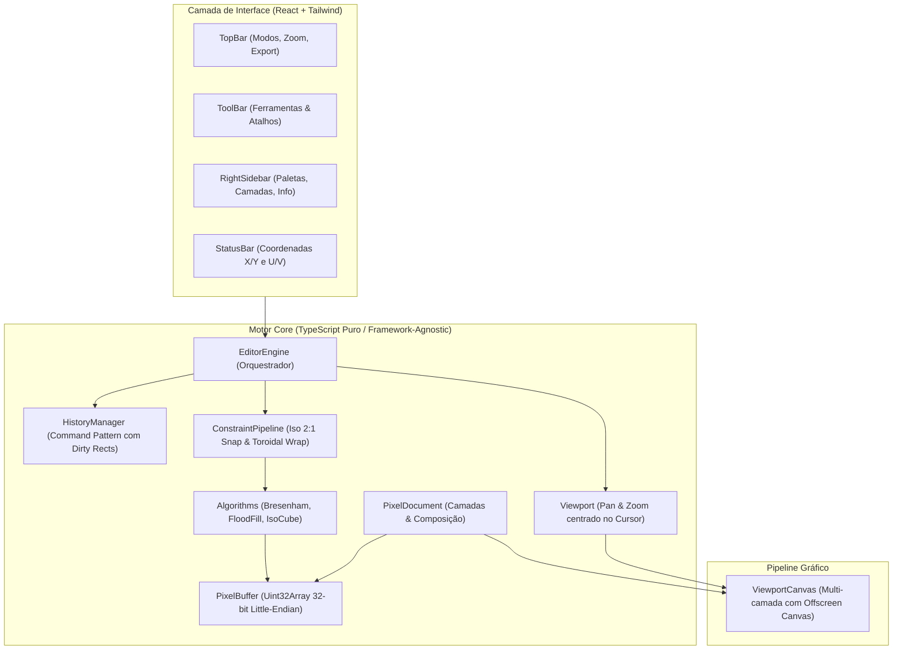

# 🌿 Garden Pixel Editor

> **Editor web moderno e especializado em Pixel Art**, com suporte nativo a **projeções por estilo** (Isométrico 2:1, Tileset Seamless Wrap e 2D Ortográfico clássico).

[](https://www.typescriptlang.org/)
[](https://react.dev/)
[](https://vitejs.dev/)
[](https://tailwindcss.com/)

---

## 🎯 Por que o Garden Pixel Editor?

A maioria dos editores tradicionais (como Aseprite e Piskel) foi desenhada como telas 2D ortográficas planas. Quando artistas precisam criar **arte isométrica** ou **tilesets contínuos**, o processo se torna manual e frustrante: é necessário contar pixels para manter o ângulo 2:1, evitar *jaggies* (degraus irregulares) e testar repetições em ferramentas externas.

O **Garden Pixel Editor** resolve isso tornando os **estilos de projeção cidadãos de primeira classe**: as ferramentas e o pincel adaptam seu comportamento matemático dependendo do modo ativo.

---

## 📐 Modos de Estilo & Projeção

### 1. 🔷 Modo Isométrico 2:1 (Dimétrico canônico de jogos)
* **Trava Angular 2:1 Nativa:** A ferramenta de Linha (`L`) trava automaticamente nos eixos de **$\pm 26.565^\circ$ ($\Delta x = \pm 2, \Delta y = 1$)** e vertical **$90^\circ$**, garantindo traços perfeitamente limpos e sem pixels desalinhados.
* **Ferramenta de Bloco 3D (`C`):** Permite clicar e arrastar para gerar prismas isométricos volumétricos completos com **faces superior, esquerda e direita sombreadas dinamicamente** a partir da cor escolhida.
* **Grade Isométrica em Diamante:** Guia visual calculada diretamente em espaço de canvas.
* **Coordenadas Isométricas $(U, V)$:** Exibição da posição na projeção isométrica em tempo real na barra de status.

### 2. 🔁 Modo Tileset Seamless (Wrap-around Contínuo)
* **Canvas Toroidal:** Pinceladas que ultrapassam qualquer borda dobram instantaneamente para a borda oposta ($X \pmod W, Y \pmod H$).
* **Ghost Preview 3×3:** O canvas renderiza 8 cópias translúcidas ao redor da área central em tempo real, permitindo avaliar a continuidade do padrão sem sair do editor.

### 3. ⬛ Modo 2D Ortográfico Clássico
* Modo pixel art tradicional 1:1, com suporte à tecla <kbd>Shift</kbd> na ferramenta de Linha para travar em $0^\circ, 45^\circ$ ou $90^\circ$.

---

## 🏛️ Arquitetura do Software

O projeto segue uma arquitetura desacoplada e modular:



### Principais Decisões de Engenharia:
1. **Desacoplamento Total do Core:** Toda a lógica gráfica e de regras matemáticas reside em `src/core/`, permitindo testes unitários fáceis ou portabilidade para desktop (Electron/Tauri) sem tocar na engine.
2. **Buffer 32-bit (`Uint32Array`):** Cores representadas diretamente como inteiros de 32 bits (`0xAABBGGRR`), permitindo operações de acesso e blending ultrarrápidas via bitwise.
3. **Undo/Redo Leve via Dirty Rects:** Em vez de clonar o canvas inteiro a cada traço, o `DrawRectCommand` grava apenas o retângulo delimitador $[minX, minY, width, height]$ dos pixels alterados, mantendo o consumo de memória estável mesmo após centenas de ações.
4. **Escala Nearest-Neighbor sem Blur:** Renderização com `imageSmoothingEnabled = false` para nitidez absoluta em qualquer nível de zoom (1x a 64x).

---

## 📁 Estrutura de Diretórios

```
garden-pixel-editor/
├── src/
│   ├── core/                        # Motor Core em TypeScript Puro
│   │   ├── types.ts                 # Tipagens centrais (Point, Rect, Layer, Frame, ToolType, ProjectionMode)
│   │   ├── color.ts                 # Utilitários de cor 32-bit e alpha blend
│   │   ├── pixel-buffer.ts          # Matriz de pixels com suporte a extração/blitting
│   │   ├── history.ts               # Histórico de Undo/Redo com Dirty Rects
│   │   ├── constraints.ts           # Algoritmos de trava angular 2:1 e wrap de coordenadas
│   │   ├── algorithms.ts            # Bresenham, Flood Fill, Cubo, Cilindro, Rampa, Elipse e Dither
│   │   ├── shading.ts               # Degraus de luminância da paleta e substituição de cor
│   │   ├── project-file.ts          # Serialização .garden e autosave no localStorage
│   │   ├── normal-map.ts            # Geração de normal map Sobel/Bevel e iluminação 2.5D
│   │   ├── palette-importer.ts      # Parser de .hex, .gpl e amostragem de imagens
│   │   ├── spritesheet.ts           # Gerador de atlas/spritesheets e metadados JSON
│   │   ├── document.ts              # Modelo multi-frames, camadas e composição
│   │   ├── viewport.ts              # Câmera com Pan e Zoom centrado no cursor
│   │   ├── editor-engine.ts         # Orquestrador central e gerenciador de animação/ferramentas
│   │   ├── palettes.ts              # Paletas clássicas embutidas
│   │   └── export.ts                # Exportador PNG em escalas 1x a 16x
│   ├── components/                  # Componentes de Interface (React)
│   │   ├── ViewportCanvas.tsx       # Canvas interativo com onion skinning, tiling e cursores
│   │   ├── BrushSettingsBar.tsx     # Barra de pincel: tamanho, pixel-perfect, dither e sombreamento
│   │   ├── Timeline.tsx             # Linha do tempo de frames, FPS e onion skinning
│   │   ├── TopBar.tsx               # Barra superior com persistência, modos e exportação
│   │   ├── ToolBar.tsx              # Barra de ferramentas vertical expandida
│   │   ├── RightSidebar.tsx         # Paletas de cores, camadas e guia de estilo
│   │   ├── StatusBar.tsx            # Barra de status com coordenadas reais e isométricas
│   │   ├── ColorSwapModal.tsx       # Modal de substituição global de cores
│   │   ├── PaletteModal.tsx         # Modal de importação/exportação de paletas
│   │   ├── NormalMapModal.tsx       # Modal de geração de mapa de normais e prévia 2.5D
│   │   └── SpritesheetModal.tsx     # Modal de exportação de spritesheets/atlas
│   ├── App.tsx                      # Casca da aplicação e listener de atalhos globais
│   ├── index.css                    # Configuração de tema e Tailwind CSS v4
│   └── main.tsx                     # Ponto de entrada React
├── package.json
└── vite.config.ts
```

---

## ⌨️ Atalhos de Teclado

| Tecla | Ação |
| :--- | :--- |
| <kbd>Espaço</kbd> + Arrastar | Panning da Câmera |
| <kbd>Scroll do Mouse</kbd> | Zoom suave centrado no cursor |
| <kbd>M</kbd> / <kbd>S</kbd> | Seleção Marquee (Arrastar / Recortar pixels) |
| <kbd>B</kbd> | Lápis / Pincel |
| <kbd>E</kbd> | Borracha |
| <kbd>L</kbd> | Reta (trava em 2:1 no modo isométrico) |
| <kbd>R</kbd> | Retângulo 2D |
| <kbd>O</kbd> | Círculo / Elipse (com proporção isométrica no modo Iso) |
| <kbd>D</kbd> | Pincel Dithering (Padrões de retícula xadrez, disperso ou Bayer) |
| <kbd>C</kbd> | Bloco 3D Isométrico (com luz e sombra) |
| <kbd>Y</kbd> | Cilindro 3D Isométrico (topo elíptico + projeção de altura) |
| <kbd>P</kbd> | Rampa / Telhado 3D Isométrico (ângulo de declive 2:1) |
| <kbd>G</kbd> | Balde de Tinta (*Flood Fill*) |
| <kbd>I</kbd> | Conta-gotas (*Color Picker*) |
| <kbd>[</kbd> / <kbd>]</kbd> | Diminuir / Aumentar tamanho do pincel (1px a 4px) |
| <kbd>,</kbd> / <kbd>.</kbd> | Frame anterior / próximo na Timeline |
| <kbd>Ctrl+S</kbd> | Salvar Projeto nativo (`.garden`) |
| <kbd>Delete</kbd> / <kbd>Backspace</kbd> | Excluir área selecionada |
| <kbd>Esc</kbd> | Desmarcar seleção |
| <kbd>Ctrl+A</kbd> | Selecionar tudo |
| <kbd>Ctrl+Z</kbd> | Desfazer (*Undo*) |
| <kbd>Ctrl+Y</kbd> / <kbd>Ctrl+Shift+Z</kbd> | Refazer (*Redo*) |

---

## 🎬 Linha do Tempo & Animação

* **Multi-Frames Nativo:** Crie, duplique, reordene e exclua quadros de animação em uma faixa de reprodução inferior docked.
* **Controles de Reprodução:** Play/Pause com taxa de quadros configurável (1 a 30 FPS).
* **Onion Skinning:** Visualização em papel vegetal com traços do quadro anterior (vermelho/âmbar a 30%) e quadro seguinte (azul/ciano a 30%).
* **Exportação para Atlas:** Exporte animações completas direto para Spritesheets e arquivos de metadados JSON.

---

## 💾 Persistência de Projetos & Autosave

* **Formato Nativo `.garden`:** Estrutura JSON com metadados e camadas codificadas em base64 (`Uint32Array`), preservando frames, camadas, paleta e modos.
* **Autosave à Prova de Falhas:** Gravação automática silenciosa em `localStorage` a cada pincelada ou alteração com restauração em 1 clique na TopBar.

---

## 🖌️ Ferramentas Avançadas de Pixel Art

* **Tamanho de Pincel Ajustável:** 1px, 2px, 3px ou 4px para traçado rápido ou preenchimento de áreas.
* **Modo Pixel-Perfect:** Algoritmo que detecta e remove cantos em L duplos em tempo real, gerando contornos perfeitos de 1 pixel de espessura.
* **Padrões de Dithering:**
  * *Checker 50%*: Padrão xadrez clássico para transições de cor estilo 16-bit.
  * *Sparse 25%*: Retícula dispersa suave.
  * *Bayer 2×2*: Matriz de meio-tom ordenada.
* **Assistente de Sombreado & Troca de Cor:**
  * Clarear / Escurecer com base nos degraus de luminância da paleta ativa.
  * Substituição global de cores (por camada ativa ou restrita à seleção marquee).

---

## 📦 Primitivas Volumétricas Isométricas Expandidas

* **Bloco 3D (`C`):** Cubos e paralelepípedos com faces superior, esquerda e direita sombreadas.
* **Cilindro 3D (`Y`):** Topo elíptico isométrico com extrusão vertical para tubos, colunas e tambores.
* **Rampa / Telhado 3D (`P`):** Primitiva inclinada ao longo do eixo isométrico para telhados e escadas.

---

## 🎨 Paletas & Importador

* **Paletas Embutidas:** PICO-8 (16 cores), Game Boy Original (4 tons), EDG 32 (Endesga) e Neon Cyberpunk.
* **Importador Universal:**
  * Importação direta de arquivos `.hex` (padrão Lospec) e `.gpl` (GIMP / Aseprite).
  * Extração inteligente de cores a partir de qualquer imagem (PNG, JPG, WebP) com amostragem e limite customizável de cores.
  * Exportação da paleta ativa para `.hex` ou `.gpl`.

---

## 💡 Normal Maps 2.5D & Spritesheets

* **Gerador de Mapas de Normais:** Cálculo de vetores tangentes via gradientes de Sobel com arredondamento de silhueta (*Bevel*), suporte a inclinação isométrica (~30°) e formatos OpenGL/DirectX.
* **Prévia Interativa 2.5D:** Iluminação dinâmica em tempo real com fonte de luz pontual interativa e modelo Blinn-Phong.
* **Atlas & Spritesheet:** Exportação em tiras horizontais, verticais ou grids por frames, camadas ou fatias de tiles, acompanhado de arquivo de metadados `.json` compatível com Phaser, Godot, PixiJS e Unity.

---

## 🚀 Como Executar Localmente

### Pré-requisitos
* **Node.js** (versão 18+ recomendada)
* **npm**

### Instalação e Execução
```bash
# Acesse a pasta do projeto
cd garden-pixel-editor

# Instale as dependências
npm install

# Inicie o servidor de desenvolvimento
npm run dev
```

Abra `http://localhost:5173` no navegador.

---

## 🗺️ Roadmap & Status das Fases

- [x] **Linha do Tempo & Animação:** Suporte a múltiplos quadros (frames), taxa de FPS configurável, Onion Skinning e exportação de spritesheets.
- [x] **Seleção & Transformação:** Ferramenta Marquee (`M`), seleção flutuante com arraste, atalhos de espelhamento Horizontal/Vertical e limpeza.
- [x] **Importador de Paletas:** Suporte a `.gpl` (GIMP/Aseprite), `.hex` (Lospec), amostragem de imagens e persistência local.
- [x] **Normal Map & Iluminação 2.5D:** Geração automática com bevel, preview interativo com ponto de luz 3D e exportação PNG.
- [x] **Exportação de Spritesheet & Atlas:** Atlas de frames de animação, camadas, grid de tiles ou wrap 3×3 com metadados JSON para engines.
- [x] **Persistência de Projeto Nativa:** Formato `.garden` (JSON + base64 buffers), diálogo de arquivo e autosave contínuo com restauração pós-crash.
- [x] **Pixel Art Avançado:** Pincel com tamanhos 1–4px, Pixel-Perfect, Dithering (Checker, Sparse, Bayer), Elipses 2D/Iso.
- [x] **Primitivas Volumétricas 3D:** Blocos (`C`), Cilindros (`Y`) e Rampas/Telhados (`P`) isométricos.
- [x] **Color Grading & Shading:** Degraus de sombra da paleta e substituição de cor pontual ou por seleção.

---

## 📄 Licença

Distribuído sob a licença MIT. Sinta-se livre para usar, modificar e contribuir!
