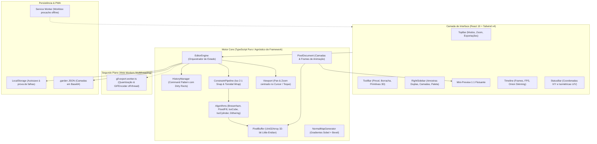

# 🌿 Garden Pixel Editor

> **Editor web profissional de Pixel Art & Isometria 2:1 para Games**, com motor gráfico raster dedicado em `Uint32Array`, iluminação 2.5D dinâmica via Normal Maps, suporte a PWA 100% Offline, exportação multithread em Web Workers e projeções canônicas de jogos.

[](https://github.com/FelipeGardenghiDev/garden-pixel-editor/actions/workflows/ci.yml)
[](https://vitest.dev/)
[](https://web.dev/progressive-web-apps/)
[](https://www.typescriptlang.org/)
[](https://react.dev/)
[](https://vitejs.dev/)
[](https://tailwindcss.com/)
[](https://oxc.rs/)

> 🌐 **Live Demo (Produção):** [https://felipegardenghidev.github.io/garden-pixel-editor/](https://felipegardenghidev.github.io/garden-pixel-editor/)

---

## 🎯 Por que o Garden Pixel Editor?

Softwares de pixel art convencionais (como Aseprite e Piskel) foram concebidos sob telas bidimensionais ortogonais planas. Quando um artista ou desenvolvedor de jogos precisa criar **arte isométrica (tilesets de chão, paredes, prédios e personagens)**, o processo exige contagem manual de pixels para evitar *jaggies* (degraus irregulares), além de testes manuais em game engines externas para verificar alinhamento e repetição.

O **Garden Pixel Editor** transforma a **isometria e o design de tilesets em recursos centrais de primeira classe**:
* **Motor Raster Otimizado:** Operações pixel a pixel diretamente em buffers `Uint32Array` (Little-Endian 32-bit), com renderização desacoplada de frameworks.
* **Projeção Isométrica 2:1 Nativa:** Trava matemática nos eixos canônicos de jogos ($\pm 26.565^\circ$, $\Delta x = \pm 2, \Delta y = 1$ e vertical $90^\circ$).
* **Primitivas Volumétricas 3D:** Geração em 1 clique de Cubos/Blocos (`C`), Cilindros (`Y`) e Rampas/Telhados (`P`) com iluminação e sombreamento automático de faces.
* **Repetição Isométrica (Floor Map Tiling):** Visualização em tempo real de como o tile se repete como chão contínuo em grade diamante 2:1 (3×3, 5×5 ou 7×7) com exportação direta de mapa montado.
* **Iluminação Dinâmica 2.5D & Normal Maps:** Geração automática de mapa de normais (Sobel + Bevel) com ponto de luz 3D interativo controlado pelo mouse.
* **Multithreading com Web Workers:** Codificação de GIFs animados pesados e quantização de paletas em segundo plano sem congelar a interface.
* **PWA & Offline Completo:** Instalável como aplicativo nativo no Windows, macOS, iPadOS e Android, com funcionamento 100% offline via Service Worker.

---

## 📐 Modos de Estilo & Projeção

### 1. 🔷 Modo Isométrico 2:1 (Dimétrico canônico de RPGs e RTS)
* **Trava Angular 2:1 Automática:** A ferramenta de Linha (`L`) trava com precisão sub-pixel nos eixos isométricos, impedindo traços tortos ou jaggies.
* **Primitivas 3D Paramétricas:**
  * **Bloco 3D (`C`):** Extrusão isométrica com auto-sombreamento das faces topo, esquerda e direita.
  * **Cilindro 3D (`Y`):** Elipse isométrica 2:1 no topo com corpo sombreado.
  * **Rampa 3D (`P`):** Telhado e declive no ângulo canônico de inclinação.
* **Repetição Isométrica (Floor Tiling):** Modo dedicado para conferir se pedras, grama, água e pisos se encaixam perfeitamente na malha diamante de um mapa de jogo.

### 2. 🔁 Modo Tileset Seamless (Wrap-around Contínuo)
* **Canvas Toroidal:** Pinceladas que ultrapassam qualquer borda dobram instantaneamente para a borda oposta ($X \pmod W, Y \pmod H$).
* **Ghost Preview 3×3:** O canvas renderiza 8 cópias translúcidas ao redor da área central em tempo real, permitindo avaliar a continuidade do padrão sem sair do editor.

### 3. ⬛ Modo 2D Ortográfico Clássico
* Modo pixel art tradicional 1:1, com suporte à tecla <kbd>Shift</kbd> na ferramenta de Linha para travar em $0^\circ, 45^\circ$ ou $90^\circ$.

---

## 🏛️ Arquitetura do Software

O projeto segue padrões de engenharia de software de nível sênior (Clean Architecture, desacoplamento total do motor e multithreading via Web Workers):



### Principais Decisões Técnicas:
1. **Desacoplamento Total do Core:** Toda a lógica gráfica, de regras matemáticas e de serialização reside isolada em `src/core/`, viabilizando 64 testes unitários automatizados e permitindo portar o motor para Electron, Tauri ou Node sem reescrever uma única linha de código.
2. **Buffer de Cores 32-bit (`Uint32Array`):** Cada pixel é manipulado diretamente como um inteiro de 32 bits (`0xAABBGGRR`). Misturas de cor (*alpha blending*) e leituras ocorrem via operadores bitwise com custo computacional mínimo.
3. **Histórico via Retângulos Delimitadores (*Dirty Rects*):** Em vez de clonar o buffer inteiro a cada pincelada, o `DrawRectCommand` grava apenas o *bounding box* dos pixels alterados, mantendo o consumo de memória ultrabaixo mesmo após 200 ações consecutivas.
4. **Multithreading com Web Worker:** A exportação de GIFs pesados executa em uma thread separada (`gif-export.worker.ts`), transferindo o buffer de bytes diretamente via zero-copy (`ArrayBuffer` transfer) com barra de progresso em tempo real e mantendo a interface a 60 FPS estáveis.
5. **Ergonomia Multiplataforma (Desktop + Mobile):**
   * **Desktop:** Amostras de cores duplas (Primária e Secundária com atalho `X`), clique com botão direito para pintar com a cor secundária, barra superior compacta para telas de notebook e barra lateral retrátil.
   * **Tablets e Celulares:** Multitoque nativo com pinça (*pinch-to-zoom*), arrastar com 2 dedos para pan suave, toque de 2 dedos para **Desfazer (Undo)** e toque de 3 dedos para **Refazer (Redo)** (estilo Procreate).

---

## ⌨️ Atalhos de Teclado & Gestos Touch

| Entrada / Tecla | Ação |
| :--- | :--- |
| <kbd>Botão Esquerdo</kbd> | Pintar com a Cor Primária |
| <kbd>Botão Direito</kbd> | Pintar com a Cor Secundária |
| <kbd>X</kbd> | Inverter Cores Primária e Secundária |
| <kbd>Toque 2 Dedos</kbd> | Desfazer (*Undo* em Tablets e Celulares) |
| <kbd>Toque 3 Dedos</kbd> | Refazer (*Redo* em Tablets e Celulares) |
| <kbd>2 Dedos (Arrastar / Pinça)</kbd> | Pan e Zoom suave na tela |
| <kbd>Espaço</kbd> + Arrastar | Panning da Câmera (Desktop) |
| <kbd>Scroll do Mouse</kbd> | Zoom centrado no cursor (1x a 64x) |
| <kbd>B</kbd> | Pincel / Lápis (com suporte a Pixel-Perfect) |
| <kbd>E</kbd> | Borracha |
| <kbd>D</kbd> | Pincel Dithering (Padrões Checker, Sparse e Bayer) |
| <kbd>L</kbd> | Reta (com trava automática 2:1 no modo Isométrico) |
| <kbd>R</kbd> | Retângulo 2D |
| <kbd>O</kbd> | Círculo / Elipse (com proporção isométrica no modo Iso) |
| <kbd>C</kbd> | Bloco 3D Isométrico (Cubo paramétrico com auto-shading) |
| <kbd>Y</kbd> | Cilindro 3D Isométrico (Topo elíptico + altura 3D) |
| <kbd>P</kbd> | Rampa / Telhado 3D Isométrico (Declive 2:1) |
| <kbd>G</kbd> | Balde de Tinta (*Flood Fill* com tolerância) |
| <kbd>I</kbd> | Conta-gotas (*Color Picker*) |
| <kbd>M</kbd> | Seleção Marquee Retangular (Mover, recortar, duplicar) |
| <kbd>[</kbd> / <kbd>]</kbd> | Degrau de sombra mais escuro / mais claro da paleta |
| <kbd>,</kbd> / <kbd>.</kbd> | Frame anterior / próximo na Linha do Tempo |
| <kbd>Ctrl+S</kbd> | Salvar Projeto nativo (`.garden`) |
| <kbd>Ctrl+Z</kbd> | Desfazer (*Undo*) |
| <kbd>Ctrl+Y</kbd> | Refazer (*Redo*) |
| <kbd>?</kbd> | Abrir Guia Visual de Atalhos de Teclado |

---

## 📦 Formatos de Exportação Suportados

1. **PNG Escalável (1x a 16x):** Upscale nítido via nearest-neighbor sem interpolação bilinear.
2. **GIF Animado (.gif):** Gerado via Web Worker com taxa de FPS customizável (1–24), fundo transparente ou com cor de preenchimento e loop contínuo.
3. **Código Web Puro:**
   * **CSS Box-Shadow:** 1 única tag `<div>` HTML estilizada inteiramente com sombras de pixels coloridos (ideal para ícones sem arquivos externos).
   * **HTML5 Canvas 2D:** Script JavaScript autocontido para desenhar o sprite programaticamente.
   * **SVG Vetorial:** Arquivo `.svg` com renderização `shape-rendering="crispEdges"`.
4. **Spritesheet & Atlas JSON:** Exportação em tiras horizontais, verticais ou matriz grid com metadados estruturados para engines (Phaser, Godot, PixiJS e Unity).
5. **Normal Maps 2.5D (.png):** Textura de relevo nos padrões DirectX (-Y) ou OpenGL (+Y) com inclinação isométrica de 30° para motores modernos com iluminação dinâmica.
6. **Mapa de Repetição Isométrica (Floor Map .png):** Exportação direta do grid de tiles montado como piso de jogo.
7. **Formato Nativo `.garden`:** Arquivo JSON com buffers de camadas em base64 para troca e backup de projetos inteiros.

---

## 📁 Estrutura do Código-Fonte

```
garden-pixel-editor/
├── src/
│   ├── core/                        # Motor Core em TypeScript Puro
│   │   ├── algorithms.ts            # Bresenham, FloodFill, Cubo, Cilindro, Rampa, Elipse e Dithering
│   │   ├── code-export.ts           # Exportador CSS (box-shadow), Canvas 2D script e SVG vetorial
│   │   ├── color.ts                 # Operações bitwise de cor 32-bit e conversão hex/rgba
│   │   ├── constraints.ts           # Trava angular 2:1 e coordenadas toroidal wrap
│   │   ├── document.ts              # Modelo multi-frames, camadas e composição
│   │   ├── editor-engine.ts         # Orquestrador de ferramentas, cor primária/secundária e histórico
│   │   ├── export.ts                # Renderização e download de PNGs em escalas 1x a 16x
│   │   ├── gif-export.ts            # Codificação de GIF animado via gifenc
│   │   ├── gif-worker-client.ts     # Cliente assíncrono para execução do GIF em Web Worker
│   │   ├── history.ts               # Histórico de Undo/Redo com Dirty Rects
│   │   ├── normal-map.ts            # Filtro Sobel, chanfro de silhueta e iluminação Blinn-Phong
│   │   ├── palette-importer.ts      # Parsers para arquivos .hex, .gpl e amostragem de imagem
│   │   ├── palettes.ts              # Paletas clássicas embutidas (PICO-8, Game Boy, EDG 32)
│   │   ├── pixel-buffer.ts          # Matriz de pixels em Uint32Array com extração de sub-retângulos
│   │   ├── project-file.ts          # Serialização .garden e autosave no localStorage
│   │   ├── shading.ts               # Degraus de luminância da paleta e substituição de cor
│   │   ├── spritesheet.ts           # Empacotador de spritesheet e gerador de atlas JSON
│   │   ├── types.ts                 # Tipagens centrais
│   │   └── viewport.ts              # Câmera com pan e zoom centrado no cursor/toque
│   ├── workers/
│   │   └── gif-export.worker.ts     # Web Worker para codificação de GIF off-thread
│   ├── components/                  # Interface do Usuário (React)
│   │   ├── BrushSettingsBar.tsx     # Tamanho do pincel, dither, pixel-perfect e atalhos
│   │   ├── CodeExportModal.tsx      # Modal de exportação para CSS, Canvas 2D e SVG
│   │   ├── FloatingPreview.tsx      # Mini-preview 1:1, 2x e 4x em tempo real com playback
│   │   ├── GifExportModal.tsx       # Exportador de GIF animado com barra de progresso do Worker
│   │   ├── IsometricTilingModal.tsx # Prévia de chão e mapa isométrico 2:1 em diamante
│   │   ├── NewProjectModal.tsx      # Criação de projetos e redimensionamento de canvas com âncora
│   │   ├── NormalMapModal.tsx       # Iluminação 2.5D interativa com luz dinâmica e presets
│   │   ├── PaletteModal.tsx         # Importação de arquivos .hex/.gpl e extração de imagens
│   │   ├── RightSidebar.tsx         # Amostras duplas, troca de cores (X) e gerenciador de camadas
│   │   ├── ShortcutsModal.tsx       # Guia visual de atalhos e gestos touch (?)
│   │   ├── SpritesheetModal.tsx     # Gerador de atlas/spritesheets em tiras ou grid
│   │   ├── StatusBar.tsx            # Coordenadas em tempo real (Pixel X/Y e Isométrico U/V)
│   │   ├── Timeline.tsx             # Faixa de frames com miniaturas ao vivo e onion skinning
│   │   ├── ToolBar.tsx              # Barra de ferramentas com acesso rápido a todas as funções
│   │   ├── TopBar.tsx               # Menu superior unificado, controle de zoom e modos
│   │   └── ViewportCanvas.tsx       # Canvas de alta performance com suporte a multitoque
│   ├── App.tsx                      # Casca da aplicação e listener global de atalhos
│   ├── index.css                    # Scrollbars estilizadas dark e temas
│   └── main.tsx                     # Ponto de entrada com registro de Service Worker
├── .github/workflows/
│   └── ci.yml                       # Pipeline de validação (Node 22, Oxlint, Vitest Coverage, Build, Pages)
├── package.json
└── vite.config.ts                   # Configuração do Vite com Tailwind e VitePWA
```

---

## 🧪 Testes Automatizados & Qualidade de Código

O repositório conta com **64 testes unitários automatizados** rodando com `@vitest/coverage-v8` e linting estático com `oxlint`:

```bash
# Executar todos os 64 testes unitários
npm run test

# Executar testes com relatório detalhado de cobertura (v8)
npm run test:coverage

# Executar linter ultrarrápido (0 warnings garantidos)
npm run lint

# Checagem de tipos estáticos TypeScript em modo estrito
npx tsc -b

# Build de produção otimizado para deploy PWA
npm run build
```

---

## 🚀 Como Executar Localmente

### Pré-requisitos
* **Node.js** (versão 20 ou 22 LTS recomendada)
* **npm**

### Instalação e Execução
```bash
# Clone o repositório
git clone https://github.com/FelipeGardenghiDev/garden-pixel-editor.git

# Acesse a pasta
cd garden-pixel-editor

# Instale as dependências
npm install

# Inicie o servidor local de desenvolvimento
npm run dev
```

Abra seu navegador em `http://localhost:5173`. Para testar a instalação PWA no celular ou tablet, acesse o endereço da sua rede local (ex: `http://192.168.x.x:5173`) ou a [versão pública na web](https://felipegardenghidev.github.io/garden-pixel-editor/).

---

## 🌐 Ecossistema Garden Apps & GC Studio

O **Garden Pixel Editor** faz parte do ecossistema de ferramentas web-first de alta performance mantido pelo **GC Studio** (Felipe Gardenghi).

Para entender o fluxo de trabalho integrado com o **GardenCut** (edição de vídeo e trailers), **VisuChord** (IA e gestos musicais) e **SimpleDrums**, consulte o guia de interoperabilidade em:
👉 **[Guia do Ecossistema Garden Apps](ECOSYSTEM.md)**

---

## 📄 Licença

Distribuído sob a licença MIT. Criado com foco em arquitetura limpa, computação gráfica para web e ergonomia para artistas e desenvolvedores de jogos independentes.
